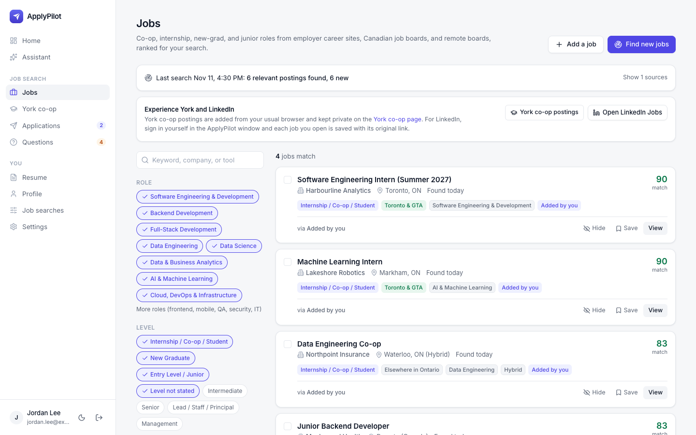
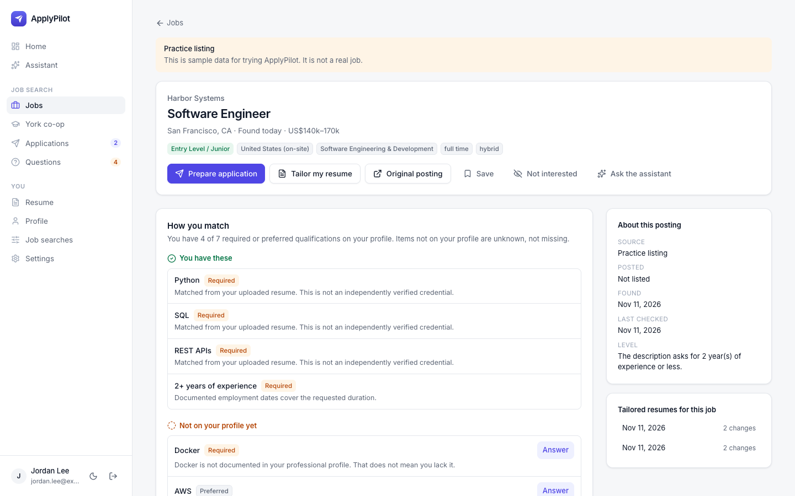
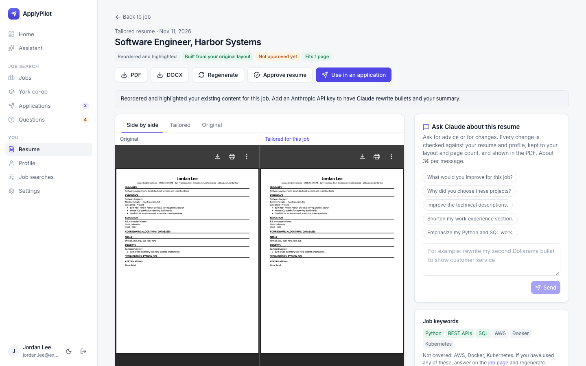
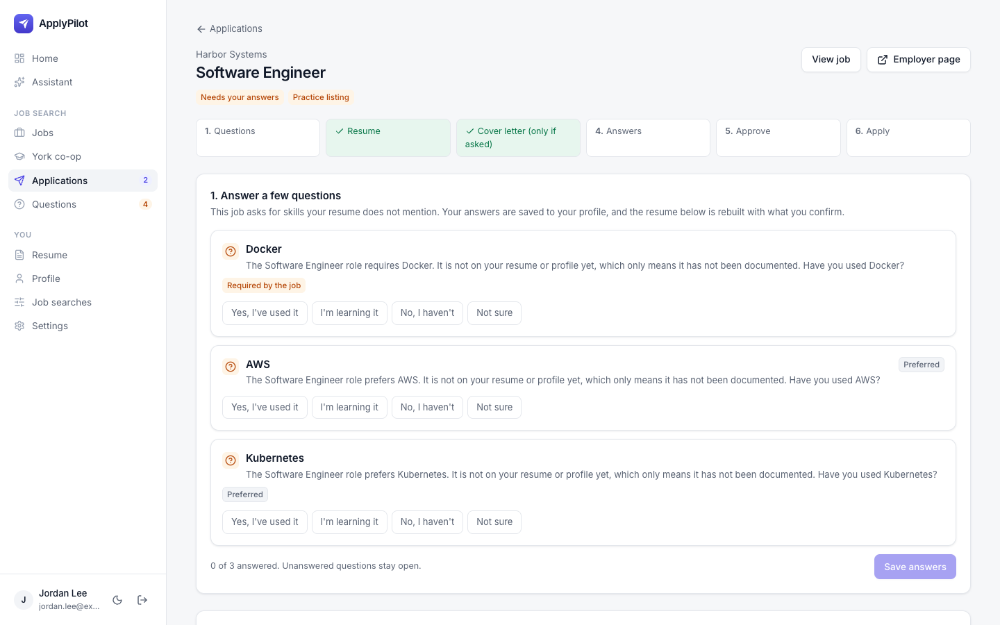
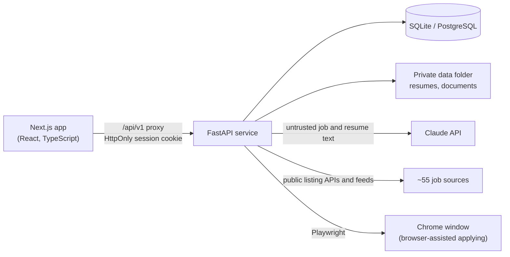

# ApplyPilot

[](https://github.com/miladse1/applypilot/actions/workflows/ci.yml)
[](https://github.com/miladse1/applypilot/actions/workflows/security.yml)

An AI-assisted job-search workspace for students and early-career engineers in Canada. It finds
co-op, internship, new-grad, and junior roles, explains how well each one fits, tailors **your own**
resume to the job without inventing anything, prepares the cover letter and answers, and waits for
your approval before anything is sent.

Full stack: **FastAPI** and SQLAlchemy on the back end, **Next.js** and TypeScript on the front end,
the **Claude API** for writing tasks, and **Playwright** for browser-assisted applications.

<p>
  
  
</p>
<p>
  
  
</p>

*Screenshots use demo mode: a fictional candidate and practice listings. No real person or employer data.*

## Why

Applying for internships means dozens of near-identical applications, each needing a slightly
different resume. Generic AI tools make that faster but tend to invent experience, which is worse
than a generic resume. ApplyPilot automates the repetitive parts and treats **truthfulness as a hard
constraint**: every AI rewrite is checked against the facts you have confirmed, and nothing is
submitted without your approval.

## What it does

- **Job discovery** from about 55 sources in parallel: employer career sites (Workday,
  SuccessFactors, Greenhouse, Lever, Ashby, and others), the Government of Canada Job Bank, and remote
  boards. Postings are classified by role, level, and location, de-duplicated (the employer's own
  posting wins), and closed or stale roles are hidden. Sites that prohibit automated reading
  (LinkedIn, Indeed, university portals) get saved-search links and a bookmarklet instead.
- **Explainable matching.** Each requirement is *matched*, *partial*, *in progress*, or *not on your
  profile yet*. Unknown is never treated as missing, and the score is labeled as what it is, not an
  ATS score or a hiring probability.
- **Layout-preserving resume tailoring.** PDF and DOCX resumes are parsed with their fonts, sizes,
  bold, dates, and bullets. Each tailored copy keeps your layout and page count, reorders and
  highlights what the job asks for and, with Claude, rewords bullets. A side-by-side view lets you
  revert or edit any change.
- **Guided applications.** Skill questions are asked only when a job needs them; then resume, cover
  letter, answers, and approval. Status changes follow a server-side state machine, and editing
  anything after approval invalidates the approval.
- **Browser-assisted applying** for Greenhouse, Lever, Ashby, and Workday in a visible Chrome window.
  It pauses for sign-ins and CAPTCHAs, never fills hidden honeypot fields, and records *submitted*
  only when the employer's confirmation page appears.
- **A tool-using assistant** (Claude) that can search, explain matches, and prepare drafts, but cannot
  approve or submit.

## Architecture



- `apps/web`: Next.js App Router UI. A route handler proxies `/api/v1` to the API and keeps the
  session token in an HttpOnly cookie, so page scripts never see it.
- `services/api`: FastAPI. Domain rules in `app/services` (discovery, matching, tailoring, documents,
  applications, auto-apply), HTTP handlers in `app/routers`, models in `app/models`, migrations in `alembic/`.
- All private runtime data (database, uploads, browser profile, logs, keys) lives outside the
  repository in `~/Library/Application Support/ApplyPilot`.

More: [docs/ARCHITECTURE.md](docs/ARCHITECTURE.md) · [docs/INTEGRATIONS.md](docs/INTEGRATIONS.md)

**Stack:** Python 3.14, FastAPI, SQLAlchemy 2, Alembic, Pydantic · Next.js 15, React 19, TypeScript,
Tailwind CSS · Anthropic SDK (Claude Sonnet, Haiku, Opus) · Playwright · PyMuPDF, pypdf, python-docx,
ReportLab · SQLite or PostgreSQL · Docker Compose · pytest, Vitest, ruff · GitHub Actions.

## Engineering decisions

| Challenge | Approach |
| --- | --- |
| LLMs invent experience | A truthfulness check rejects any rewrite that adds numbers, tools, employers, titles, or names not already on the confirmed profile. Rejected rewrites are shown, not silently used. |
| Prompt injection through job postings and resumes | Third-party text is passed to the model only inside marked untrusted blocks; structured outputs are validated, and requirements must be grounded in the posting text. |
| AI cost | Matching, ranking, and classification run locally at no cost. Claude is used only for writing tasks (about $0.01–0.03 each), Haiku for cheap checks, identical requests are cached, and every call passes a per-user budget, an installation-wide monthly ceiling, and request rate limits. |
| Keeping a resume's look | The parser records layout (fonts, sizes, bold runs, right-aligned dates, wrapped lines), and the renderer rebuilds that layout and keeps the original page count, for both PDF and DOCX. |
| 55 sources with different formats and limits | One adapter per platform, fetched in parallel in a background task with per-host pacing; one classifier for role, level, and location; duplicates merged across sources. |
| Automating real employer forms safely | A visible browser with its own profile; it stops on sign-ins, CAPTCHAs, and unknown required questions, and only an employer confirmation page counts as submitted. |
| Personal data in a public repository | Runtime data lives outside the repository; Git hooks and CI block secrets, documents, databases, and personal details; tests use fictional data only. |

## Security

- Passwords: PBKDF2-SHA256 (600,000 iterations). Sessions: random tokens stored only as hashes, 12-hour
  expiry. Rate limits on sign-in, registration, and password reset; sign-up closes after the first account.
- Writes accepted only from the app's own origin; unknown Host headers refused (DNS rebinding);
  Content-Security-Policy and other security headers; servers bound to `127.0.0.1`.
- The Anthropic key is read only by the API and never reaches the browser.
- Pre-commit and pre-push hooks (gitleaks with a custom Anthropic-key rule, blocked file types, size
  limits, personal-detail checks), full-history secret scanning and dependency audits in CI, Dependabot.

Details: [SECURITY.md](SECURITY.md) · Workflow: [docs/SECURE_WORKFLOW.md](docs/SECURE_WORKFLOW.md)

## Run it

Requirements: Python 3.14 (3.12+), Node.js 22+.

```bash
./dev.sh           # API on :8001, web app on :3000
./dev.sh stop
```

Open http://localhost:3000 and create your account. Without an Anthropic key, everything except AI
rewriting, cover-letter writing, and the AI assistant works (tailoring falls back to reordering and
highlighting). Add a key with `./configure.sh ai` (input hidden, stored outside the repository).
Demo mode (`DEMO_MODE=true`) adds labeled practice listings and a sample resume.

Running as a background Mac app, Docker, keys and email, AI cost details, and browser-assisted
applying: [docs/RUNNING.md](docs/RUNNING.md).

## Tests

```bash
cd services/api && .venv/bin/python -m pytest -q    # 127 tests: offline, in-memory database
cd apps/web && npm test && npx tsc --noEmit          # 9 tests and type check
```

The API suite covers discovery and classification, matching, resume parsing and tailoring, the
truthfulness check, application state transitions, AI cost tracking and limits, authentication and
security controls, and end-to-end browser-assisted applications against local fixture sites
(Greenhouse, Lever, Ashby, Workday flows) in headless Chrome.

## Limitations

- Browser-assisted applying depends on each site's page layout; unusual forms pause for you instead of guessing.
- Scanned (image-only) resumes cannot be read yet.
- Interview and offer updates are recorded by hand.
- Built and operated as a single-user app on macOS; rate limits live in memory, and the Mac
  background-app scripts use launchd.

## License

No open-source license is granted; all rights reserved. The code is shared for review as part of a
portfolio. Bundled fonts keep their own SIL Open Font License files.
